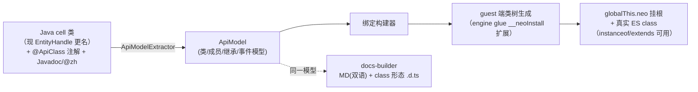

# 12 · 脚本 API 目录（全模块设计规格）

> 定位：P1/P2 实施的 **API 设计真源**。[05](05-script-api.md) 讲机制（全局注入、类挂根、注解集、绑定管线），本篇讲**全量 API 面**：双层模型、类型目录、模块完整签名、事件目录、JsMacros 迁移对照。
> 2026-11-04 需求方拍板（不可单方面推翻，变更须回写本文与 [README](README.md) 决策登记）：
> ① 仅设计规格（不实施）；② 全模块一次成稿（P0~P3 标注）；③ **统一活句柄**——查询一律返回句柄类；④ **0.x 直接演进**——允许破坏式重塑已有成员；⑤ **双层模型**——全部 API 理解为 Java 的包装 API，穿透层保完备性（废除"脚本拿不到原始对象"旧原则）；⑥ 穿透层**单闸** = `permissions:['java']` + 首次信任提示；⑦ **授信即全权**——无类名黑名单。
> **2026-11-04 第二轮修订（已拍板，真源 = `fabric-mod/api设计-补充与改进.md`，本文受其 §8 回写约束）**：位置族 `Vec2/Vec3` → **`Pos2D/Pos3D`** + 独立 `ChunkPos`（§8-1/7）；模块 **18→19**（`clock`→**`thread`**、`inventory` 裁撤并入 `player.opened`、新增 **`@neomacros/client`** 与 **`@neomacros/reflect`**，§8-2/3/14/15）；`Container` → **`Inventory`** 且**恢复屏幕特化树**（能力面差异特化 ≠ 数据差异特化，§8-12）；事件 payload 升级为 **`XxxEvent extends BaseEvent`** 冻结实例（§8-4，零破坏加原型链）+ chunk/blockUpdate 等字段改类型实例（§8-5）；删 `Player.ping`（§8-6）；运算族统一 `mul(v)`/`scale(n)`、`lookVec`→`Entity.direction`、`particle`→`spawnParticle`、`bossbars/players` 属性化、`rot`→`rotation`（§8-8~11）；**命名铁律：对齐 ECMAScript/Mojang**（无参状态属性化、名词不作动词、缩写规范，提案 §1.4）；版本注解三分 **@ApiSince/@ApiMC/@ApiLoader 应标尽标**（缺任一构建失败，提案 §9.1）；事件目录 53/53 全覆盖 + 新增补齐（提案 §7.4）。
> **2026-11-05 第三轮增补（已拍板并实施）**：新增 **`@neomacros/performance`**（§4.17，模块 19→**20**）——参考 MDN Web Performance 裁剪的 User Timing 子集：`timeOrigin/now/mark/measure/clearMarks/clearMeasures/entries/entriesByName/entriesByType`；`measure` 入参**双形**（mark 名或 now() 原始时间戳）；每脚本 **4096 条环形缓冲**（挤旧不停录）；MDN `getEntries()` 家族按**无参状态属性化铁律**落地（`entries` 只读属性 + `entriesByName/entriesByType` 带参方法）；免门控；doc-api 新增 `@ApiOptional` 参数标记（d.ts 渲染 `?`）。
> **2026-11-07 第五轮修订（已拍板并实施）**：**废除 `@neomacros/*` ESM 导入通道**——脚本只用全局 `neo.*` 单通道（早期 ESM 通道与全局指向同一批绑定对象，属纯冗余）；**全部脚本可见类直接挂 `neo` 根**（`new neo.Sheep`、`neo.Pos3D`，废除 `neo.types.*` 中间层与 `@ApiModule.global` 属性）；d.ts 改为单全局作用域（`interface NeoRoot` + `declare const neo`，类为类型级接口 + 根级构造面）。涉及 §0/§2.1/§4.0/§4.8 的历史表述按本条修订。**同日补充**：实体物种/结构/非生物实体类名一律带 `Entity` 后缀（`SheepEntity`/`MobEntity`/`PrimedTntEntity`…，`Player`/`LocalPlayer` 与已带后缀的基类除外），推翻第四轮"Mojmap 原词裸名"规则；wraps 标注保持 Mojmap FQN 原词。
> **2026-11-06 第四轮修订（已拍板，真源 = [13-jsmacros-gap-api.md](13-jsmacros-gap-api.md)）**：**推翻"物种不特化"**（§2.1 已回写）——恢复实体物种子类树（类名 = Mojmap 原词，层级镜像 Mojang，结构中间类自动生成，深度跟随 Mojang 层级，"封顶 4 层"随之废止）；**命名铁律增补**：首要贴合 Mojang 官方命名，其次 NeoMacros 规范（Mojang `getXxx()` → 属性化、动词保留 Mojang 原词如 `grabMouse`/`grabScreenshot`、类名用 Mojmap 原词不沿 JsMacros/社区俗名）；**GlobalVars 不支持不扩展**（跨脚本共享反模式既定，不做枚举）；**永久缺口唯一项** = 运行时 Java 编译/动态类生成/Jar 加载；jsmacros-compat 缺口（missing-apis.md ~1341 项）的全量映射与分期见 13 号。
> **2026-11-08 第六轮修订（已拍板并实施）**：`player.opened` → **`player.inventory`**（容器优先，默认回退玩家背包，不在世界内 undefined；`opened` 删除不保留别名）；`screen.opened` 裸 Map → **Screen 句柄族**（`XxxScreen` 类族挂根，命名对齐 `XxxEntity`，只读+`close()`，inventory/dialog 屏均为 Screen 子类）；新增 **`@neomacros/dialog`** 模块（§4.17，模块 20→**21**，`@ApiMC(">=1.21.6")` 全库首个真实版本门禁）；事件：`screen:open/close` 加 `screen` 字段、新增 `screen:change`/`inventory:close`/`inventory:click`/`dialog:open/close`、`inventory:open` 加 `containerId`（E 背包 kind 归一为 `player`）、`inventory:update` 扩 payload；容器 kind 推导改 instanceof 链并修正 enchanting/brewing/villager 三处错位。涉及 §4.0/§4.6/§4.7/§4.16/§5 的历史表述按本条修订。
> **2026-11-08 第六轮追补（需求方裁定并实施）**：`neo.screen`/`neo.dialog` 独立模块**裁撤并入 player**——`player.screen`（Screen 句柄族成员）、`player.dialog`（DialogHandle）、`player.showDialog(config)`（原 `dialog.show`）；模块 21→**19**；`DialogHandle.actions/inputs` 由 `Array<Record<string, unknown>>` 类型化为 **`DialogAction`/`DialogInput` DATA 类**（`dialog:open` 事件 payload 的 actions 同步类型化），d.ts 悬空引用（DialogActionInfo/DialogInputInfo 未定义即被引用）与 handle 域 unknown 全部消除；`showDialog` 的 `config` 沿全库配置袋惯例保留 `Record<string, unknown>`（同 command.register/input.movement/text style）。涉及 §4.0/§4.6/§4.16/§4.17 的表述按本条修订。
> **2026-11-08 第七轮修订（需求方拍板并实施）**：player 模块统计/进度/准星/交互四件套——① `LocalPlayer.statistics` 扁平 `Record<string, number>` 重塑为 **`Statistics` 句柄**（`snapshot` 保留旧扁平形态 + `entries: StatisticsEntry[]` + `value(category, key)` + mined/crafted/used/broken/pickedUp/dropped/killed/killedBy/custom 九个分类查询，`StatisticsEntry` DATA 记录）；② 新增 **`LocalPlayer.advancements`**：`Advancements` 句柄（`ids/roots/completed/started` 属性 + `get(id)`/`children(id)`）→ **`Advancement` 活句柄**（`id/parentId/title/description/frame/hidden` + `progress`）→ **`AdvancementProgress` DATA 记录**（`done/obtained/remaining`）；仅含带 display 的进度条目，进度映射 1.21.6~26.2 为私有字段、经 `ClientAdvancementsAccessor`（interface + @Accessor + neomacros$ 前缀惯例）暴露；③ 新增 **`LocalPlayer.target`**（`Target` 活句柄：`block/entity/face/pos/distance/hit`）——准星选取即交互距离的物化（补 13 号 `getTarget`/`getTargetedBlock`/`getTargetedEntity` 缺口）；端口 `RayHit` 记录的 block 字段 `BlockData`→**`BlockInteraction`**（带 face），world `RayHit` 句柄同步加 `face`；④ 交互动作面补全：`interactBlock(pos, face?, hand?)`（face 真落地，`Direction` 名，未知抛错）、`interactEntity(target, hand?)`、新增 **`interactItem(hand?)`**（持物右键空气）、**`attackBlock(pos, face?)`**（挥手 + startDestroyBlock 原语；挖掘进度需按住攻击键推进，不做假完整循环）、**`stopBreaking()`**；`swingHand(offhand)` 忽略参修复；hand 归一 `'main'|'off'`；reach 两属性保持只读，javadoc 补创造修饰说明。d.ts 根构造面 `new(...args: any[])` → **`unknown[]`**（221 处，调用面零差异）；全库签名 `any` 仅剩 `thread.runOnMain`（动态穿越特许出口，同配置袋惯例；泛型化需 d.ts 生成器加类型参数能力，留后续）。涉及 §2.3/§4.6 的历史表述按本条修订。
> 状态标注：**【已有】** 0.1.0 已实现（`docs/vitepress/public/neomacros.d.ts` 在库）；**【新增】** 本规格设计；**【重塑】** 对已有成员的破坏式演进（④ 已授权）。

## 0. 双层模型总纲

NeoMacros 的全部脚本 API 理解为 **Java 的包装 API**，分两层：

| 层 | 契约 | 内容 | 版本承诺 |
|---|---|---|---|
| **包装层**（Wrapper Layer） | **稳定性**——跨 MC 版本尽量不破，类型统一、ES 风格 | `neo.*` 全部模块 + 挂根类树（§2） | 成员变动走 `@ApiSince` 演进 |
| **穿透层**（Escape Layer） | **完备性**——凡未包装的方法/属性/类，都能直达原始 Java 类 | `neo.java` 模块 + 一切包装句柄的 `.raw` + `java.wrap()` | 不保证跨 MC 版本（文档明示） |

硬规则：

1. **包装层优先**：能包装就包装，穿透层兜底；包装层签名零 raw MC 类型（§2.4 wraps 标注让开发者自行推知底层成员面）；
2. **两层显式互转**：`handle.raw`（句柄 → JavaObject）、`java.wrap(obj)`（JavaObject → 包装句柄，未注册类型返回 `undefined`）；**不隐式自动包装**（可预测性优先，JsMacros `JavaUtils.getHelperFromRaw` 的教训是转换表不可预期）；
3. **穿透层单闸**：`permissions:['java']` + 首次信任提示（复用现有信任门）。授信即全权——可加载任意类（含 `Runtime`/`ProcessBuilder`），文档标注"等于交出电脑权限"；无类名黑名单（黑名单永远有遗漏且制造意外失败，信任提示本身就是这道闸）。

## 1. 设计原则（JsMacros 病灶 → 对策）

| # | JsMacros 病灶 | NeoMacros 对策 |
|---|---|---|
| 1 | 16 个全局库职责混杂（Chat 库塞了日志/命令管理器/文本工厂；World 塞了声音/粒子） | 模块按关注点切分（17 个各一职）；杂物抽屉库（`Utils`/`JavaUtils`）不设——剪贴板/哈希等经 `java.type` 自取 |
| 2 | ~200 个 Helper 类 + 72 个特化实体类，类型不统一、工厂链不可预期 | 能力树 + 物种子类镜像 Mojang 层级（§2.1，2026-11-06 第四轮修订）；工厂链不设（查询即句柄）；**一个概念一个类** |
| 3 | raw MC 类多条路径泄漏（`getRaw()`、事件字段、heightmap 返回原始对象） | 双层模型（§0）：raw 是受控穿透口；包装层签名零 raw 类型 |
| 4 | 取消事件三种写法并存（`cancel()` / 字段置 null / `closeScreen=true`） | 唯一语义：`onSync` 回调返回 truthy 即取消（filter 风格，既定决策） |
| 5 | Java getter 是方法、事件字段是 public 属性，两套访问约定 | 一律 getter 属性（状态）/ 方法（动作）；事件 payload 是冻结纯对象 |
| 6 | null 与空集合语义不一（`getPassengers()` 无乘客返回 null） | 缺席 = `undefined`、空 = `[]`、永不出 `null` |
| 7 | 路径基准三分（脚本夹/宏夹/config 夹） | `fs` 一律相对游戏目录（`.minecraft`），文档单一基准 |
| 8 | `JavaWrapper.methodToJava` 语言边界 | JS 函数直接传入（引擎 ProxyExecutable 桥接）；`java.proxy` 仅用于给 Java API 提供接口实现 |
| 9 | 事件名裸字符串无校验、`ANYTHING` 魔法名 | `EventCatalog` 注册制校验 + `events.catalog()` 自省；通配 `domain:*` / `*` 显式 |
| 10 | 线程模型副作用泄漏（`deferCurrentTask`、joined 阻塞语义复杂） | 异步为主；同步通道只有 `onSync`（SyncWatchdog 500ms 兜底，既定） |
| 11 | `Java.type` 在生产环境直接失败（类名是混淆名） | `java.type` 经 Fabric `MappingResolver` 做 Mojmap→运行时名翻译（§4.9，代差改进） |
| 12 | 文档 doclet 注解双副本 | doc-api 注解单一真源（既定） |

## 2. 类型系统（包装层的稳定性契约）

### 2.1 类树（能力树 + 物种子类，2026-11-06 第四轮修订）

```
Pos2D                              旋转（yaw,pitch）/ 屏幕坐标（不可变）
Pos3D                              三维点/向量合一（不可变，数学全量）
 └ BlockPos                        整格点 + 六方向语义
ChunkPos                           区块格点（独立类，不继承 Pos2D/Pos3D）
BaseEvent                          事件基类（全部事件 payload 的原型）
Text · TextBuilder                 聊天组件（不可变数据 + builder）
ItemStack · ItemStackBuilder · Item 物品（builder 构造见提案 §6.6.1）
BlockState                         方块状态（不可变数据）
Block                              方块（活句柄）
Inventory                          物品栏基类（活句柄；屏幕特化树见提案 §6.8）
 ├ PlayerInventory …               屏幕特化 16 类（P1 先落基类 + 前六类）
Entity                             实体基类（活句柄）
 ├ ItemEntity                      掉落物
 └ LivingEntity                    生物
    └ Player                       玩家
       └ LocalPlayer               本地玩家（唯一带动作面）
（物种子类树挂 LivingEntity 之下：MobEntity/AnimalEntity/SheepEntity…，类名一律带 Entity 后缀）
RayHit · Effect · Subscription     数据形态 / 冻结对象 / 订阅句柄
JavaClass · JavaObject             穿透层代理（§4.9）
```

物种子类挂载：`LivingEntity`/`Entity` 之下按 Mojang 层级挂物种子类（`VillagerEntity`/`SheepEntity`/`WolfEntity`/`CreeperEntity`/`BoatEntity`/`DisplayEntity` 系…，含结构性中间类，类名一律带 `Entity` 后缀），全量映射见 [13 号 §3](13-jsmacros-gap-api.md)。

**物种特化（2026-11-06 第四轮修订，推翻原"物种不特化"）**：恢复实体物种子类树——类名 = Mojang 类名原词 + **`Entity` 后缀**（2026-11-07 需求方补令：`VillagerEntity`/`SheepEntity`/`MushroomCowEntity`/`PrimedTntEntity`…，推翻本段最初"Mojmap 裸名"并统一避免挂根后的泛名歧义；不用 JsMacros `XxxEntityHelper` 亦不用社区俗名；`Entity`/`LivingEntity`/`ItemEntity`/`Player`/`LocalPlayer` 已带实体语义不加），层级**镜像 Mojang 实体类层级**，未注册的 Mojang 中间类自动生成结构性 guest 类（无自有成员，仅保证 extends 链与 `instanceof` 正确；`MobEntity`/`AnimalEntity` 等同样带后缀），深度跟随 Mojang 层级（原"封顶 4 层"废止）。JsMacros 72 个特化壳类的全量映射表（75 壳 → guest 类 → 成员 → wraps）见 [13 号 §3](13-jsmacros-gap-api.md)。能力判别仍用 `instanceof` + `entity.type` 字符串；**判别型缺口一律不设成员**（如 `isChestBoat` → `instanceof ChestBoatEntity`、`isElder` → `type === 'minecraft:elder_guardian'`）。

类构造器**直接挂 `neo` 根**（2026-11-07 修订：`new neo.Pos3D(1,2,3)`、`entity instanceof neo.Entity`，废除 `@neomacros/types`/`neo.types.*` 出口；见 §4.8），供 `instanceof` 判断与用户 `extends`。

### 2.2 数学与位置类型（第二轮修订：Pos2D/Pos3D/BlockPos/ChunkPos）

| 类 | 成员（* 为属性） | 说明 |
|---|---|---|
| `Pos2D` | `x* y*`、`add(v) sub(v) mul(v) scale(n) equals(v) toString() toJSON()` | 旋转（yaw/pitch）、屏幕坐标；运算族与 Pos3D 统一 |
| `Pos3D` | `x* y* z*`、`add(v) sub(v) mul(v) scale(n) div(v) length() lengthSq() normalize() distanceTo(v) distanceSq(v) dot(v) cross(v) lerp(v,t) withX/withY/withZ(v) floor(): BlockPos equals(v) toString() toJSON()` | **不可变**——一切运算返回新实例；`mul(v)` 分量乘 / `scale(n)` 标量乘；`toJSON()` → `{x,y,z}` 保 JSON 安全 |
| `BlockPos` extends `Pos3D` | `x y z（整数格点）`、`up() down() north() south() east() west(n?) offset(dir, n) center(): Pos3D` | 继承 Pos3D 全部方法；`intX/intY/intZ` 删除（x/y/z 即整数） |
| `ChunkPos` | `x* z*`、`new ChunkPos(x, z)` / `new ChunkPos(blockPos)`（重载）、`minX* minZ* minBlock(): BlockPos contains(pos) offset(dx, dz) equals(other) toString() toJSON()` | 独立类**不继承** Pos 系（区块格点与方块格点分属两套坐标系）；`minX = x << 4` |

约定：**一切位置参数与字段用 `Pos3D`/`BlockPos`**（句柄属性、事件 payload、查询参数同型）；`Pos3D` 接受 `{x,y,z}` 形状的对象入参（鸭子兼容，绑定层归一）。旋转用 `Pos2D(yaw, pitch)` 或分离的 `yaw`/`pitch` 数值。

### 2.3 实体类（活句柄）

| 类 | wraps | 成员（* 为属性） |
|---|---|---|
| `Entity` | `net.minecraft.world.entity.Entity` | `uuid* type* name* pos*: Vec3 blockPos*: BlockPos yaw* pitch* rot*: Vec2 valid* alive*`、`distanceTo(target: Entity\|Vec3)`、`snapshot(): EntitySnapshot`、`raw`（穿透，§2.7） |
| `ItemEntity` extends `Entity` | `...entity.item.ItemEntity` | `stack*: ItemStack` |
| `LivingEntity` extends `Entity` | `...entity.LivingEntity` | `health* maxHealth* air* maxAir* onGround* sneaking* sprinting* lookVec*: Vec3 effects*: Effect[] heldItem*: ItemStack\|undefined offhandItem*: ItemStack\|undefined armor*: ItemStack[4]（P2）`、`hasEffect(effectId)` |
| `Player` extends `LivingEntity` | `...entity.player.Player` | `gamemode*（'survival'\|'creative'\|'adventure'\|'spectator'）hunger* xp*: {level, progress, total} inventory*: PlayerInventory ping*（P2）` |
| `LocalPlayer` extends `Player` | `...client.player.LocalPlayer` | 动作面（第七轮修订）：`attack(target) interactEntity(target, hand?) interactItem(hand?) interactBlock(pos, face?, hand?) attackBlock(pos, face?) stopBreaking() swingHand(offhand) dropHeld(all)` 均 `: Promise<void>`；`look(yaw, pitch) lookAt(target) teleport(x, y, z) setVelocity(x, y, z): Promise<void>`；`respawn()`（P2，实验）；本地状态面：`statistics*: Statistics\|null advancements*: Advancements\|null target*: Target\|null blockInteractionRange* entityInteractionRange*: number isBreakingBlock* itemCooldown(id)` |

- `snapshot()` 返回冻结纯对象 `EntitySnapshot {uuid, type, name, pos: Vec3, yaw, pitch, health}`——JSON 安全、可比较、可入库。
- 本地玩家独占动作面（`LocalPlayer`），世界里的其他玩家是 `Player`——`instanceof LocalPlayer` 即判"是不是自己"，替代 JsMacros `ClientPlayerEntityHelper` 命名。
- 动作方法全部 `Promise`：服务器往返或主线程调度；拒绝即失败（`interactBlock` 被服务器拒绝等）。
- **失效语义**：实体卸载后属性读 `undefined`、方法调用 `throw`（`Error('handle no longer valid')`）——脚本崩溃不由"读了一个消失的实体"引起，但误用方法必须响亮失败。

### 2.4 世界与物品类型

| 类 | wraps | 成员（* 为属性） |
|---|---|---|
| `Block` | `net.minecraft.world.level.block.state.BlockState`（经端口 `BlockData`） | `pos*: BlockPos state*: BlockState valid*`、`raw` |
| `BlockState` | 同上（数据形态） | `id* props*: Record<string,string>（vanilla 方块属性，如 facing/open）`、`is(id)` |
| `ItemStack` | `net.minecraft.world.item.ItemStack`（经端口 `ItemStackData`） | `id* count* name* damage* maxDamage* lore*: string[] enchantments*: {id, level}[]`、`is(id) same(other)`、`raw`、`toJSON()` |
| `Item` | `...item.Item`（注册表信息） | `id* name* maxStack* maxDamage* food*（P2）` |
| `Inventory`（第二轮修订：`Container` 更名） | `...inventoryMenu` 抽象（经端口 `InventoryPort`） | `title* kind*（'player'\|'chest'\|'crafting'\|…）size*`、`slot(i): ItemStack\|undefined items: ItemStack[] findId(id): number\|undefined findAll(id): number[] contains(idOrItem): boolean freeSlot(region?): number\|undefined region(name)/regions()/regionOf(slot)`、`click(i, {button?, shift?}): Promise<void> quickMove(i): Promise<void> drop(i, all?): Promise<void> swapHotbar(i, 0..8): Promise<void> swapOffhand(i): Promise<void> close(): Promise<void>`、`raw`；屏幕特化树（`ContainerInventory`/`RecipeInventory`/`CraftingInventory`/`FurnaceInventory`/`AnvilInventory`/`PlayerInventory`…16 类）见提案 §6.8.3 |
| `PlayerInventory` extends `Inventory` | 本地玩家背包（关联 InventoryScreen） | `hotbar*: ItemStack[9] main*: ItemStack[27] armor*: ItemStack[4] offhand*: ItemStack\|undefined selected*（当前手持槽号）isInHotbar(slot): boolean`、`select(i): Promise<void>（P2）` |
| `BossBar`（P2） | 客户端 boss 条 | `uuid* name* progress* color*`（只读，服务器驱动） |

### 2.5 数据与文本类型

| 类型 | 形态 | 成员 |
|---|---|---|
| `Text` | 不可变数据 | `plain*（提取纯文本）`、`toJSON()`（组件 JSON）；经 `chat.text()` builder 构造（§4.3） |
| `Effect` | 冻结纯对象（interface，无构造器） | `effectId amplifier duration`（与端口 `EffectSnapshot` 字段名一致） |
| `RayHit` | 数据 | `block*: Block\|undefined entity*: Entity\|undefined pos*: Vec3 distance* normal*: Vec3\|undefined（P2）` |
| `PerformanceEntry` | 冻结纯对象（Java record 派生，d.ts 自动出 interface） | `name entryType（'mark'\|'measure'） startTime duration`（performance 模块条目，§4.18） |
| `EntitySnapshot` / `PlayerSnapshot` | 冻结纯对象 | 见 §2.3 / 端口模型；JS 面字段统一 `name`（内部 record 现为 `displayName`，P1 统一改名或绑定层映射，实施时定） |
| `Subscription` | 句柄 | `cancel(): void`——events/clock/input/command 的所有订阅与注册统一返回此形态 |
| 视图/形状 DATA record（2026-11-08 批；第七轮增补 `StatisticsEntry AdvancementProgress`） | 冻结纯对象（Java record 派生，d.ts 自动出 interface，组件支持 `@ApiOptional`/`@ApiType`） | `ModData WindowData ServerInfoData OptionsData MousePos KeybindData TpsData TabListData BossBarSnapshot ScoreboardData FileStat BoundingBox StatusEffectData XpInfo SlotItem EntityJson PlayerJson JsonPos JsonLook TextSegmentJson ItemStackJson Pos2DJson Pos3DJson ChunkPosJson ChunkJson ImageJson TextStyle TextStyle(Data?) DialogConfig DialogActionSpec CommandSpec MovementSpec FindBlocksOptions RequestInit StatisticsEntry AdvancementProgress`；句柄类补齐 `Subscription(events) InputSubscription TimerHandle CommandArg CommandContext Response`；值类别 `JsonValue`（递归 JSON 值）与 `JavaObject` 反代类型全面替代签名中的 unknown |
| `JavaClass` / `JavaObject` | 穿透代理 | §4.9 |

### 2.6 形态规则（全 API 通用）

1. **统一活句柄**（本轮拍板③）：一切查询返回句柄类——`entity.inRadius()` → `Entity[]`、`world.blockAt()` → `Block`、`raycast()` → `RayHit`（内嵌句柄）；快照只出现在**事件 payload** 与显式 `.snapshot()`；
2. **缺席 = `undefined`，空 = `[]`，永不出 `null`**（含 Java 侧 null 的既有出边界转换）；
3. **读同步、动作异步**：属性/查询同步立即返回；凡是服务器往返、主线程调度、IO 的动作用 `Promise`；
4. **Handle 失效**：属性 `undefined`、方法 `throw`；**同步方法 throw / 异步方法 reject**；
5. **id 参数**：一律接受省略命名空间（默认 `minecraft:`），返回一律全名（`minecraft:pig`）；
6. **时间**：现实时间用 `Date.now()`（ES 原生，不重复造，墙钟唯一入口）；游戏内时间 `world.time`（tick）；**耗时测量**用 `performance.now()`（微秒精度单调，第三轮增补 §4.18——与墙钟分工：`Date.now()` 记时刻、`performance` 量时长）；
7. **事件 payload** = 冻结纯对象（位置/物品字段用 `Vec3`/`ItemStack` 实例，`toJSON()` 保证 `JSON.stringify` 安全）。

### 2.7 wraps 标注与 `.raw` 穿透口

- 每个包装类在**文档头声明 `wraps: <Mojmap 类名>`**——doc-api 注解新增 `@ApiClass(name, kind, wraps?)`（替代现 `@ApiHandle`），docs-builder 渲染为类文档页头部的"wraps"徽标；开发者据此推知 raw 层可用成员面；
- `raw` getter **推迟**（cell 经端口回读快照、不持原始 MC 对象——需 adapter 级 raw 通道设计）；原设计为`raw` getter 返回 `JavaObject` 代理（§4.9），受 `permissions:['java']` 单闸门控；纯自有类型（`Vec2`/`Vec3`/`BlockPos`/`Text`/`Effect`/快照）无 `raw`；
- raw 的成员访问使用 **Mojmap 命名**（与包装层文档同一套名字），生产环境由映射解析翻译（§4.9）。

## 3. 类绑定机制与单一真源



要点（对 [05 §3](05-script-api.md) 机制的修订）：

1. **Java cell 仍是唯一真源**：getter/方法注解与 Javadoc 写在 Java 侧（现状不变，`EntityHandle` 等 cell 类更名为裸类名 `Entity`/`Player`，`@ApiHandle` 更名 `@ApiClass(kind: handle|data, wraps?)`）；
2. **guest 端真实 ES 类**：engine glue 按 ApiModel **生成**类树（`class LivingEntity extends Entity`，实例包裹 Java cell：getter 转发、方法转发、`Symbol.toStringTag`、`raw` 穿透经权限检查）——`e instanceof LivingEntity` 与用户 `class MyEntity extends ...` 原生可用；禁止手写 JS API 面（文档/绑定/.d.ts 同源）；
3. **`.d.ts` 生成 class 声明**（含 `extends` 链），替代现在的 interface 形态；
4. **管线触点**：`@ApiModule` 集合变化须同步 VitePress `config.mts` 侧边栏（既有规则）；类树图由 docs-builder 自动生成进各模块文档页头；script-tests 每模块回归用例（§7）。

## 4. 模块 API 面（19 模块）

### 4.0 总览（第六轮追补：19 模块——screen/dialog 并入 player）

| 全局 | 职责 | 权限 | 阶段 | 现状 |
|---|---|---|---|---|
| `neo.thread`（第二轮修订：`clock` 更名） | 线程自省 + 异步原语 + 定时器 | 无 | P0/P1 | 【重塑】+【新增】 |
| `neo.events` | EventEmitter 订阅 + 自省 | 无 | P0/P1 | 【已有】+【新增】 |
| `neo.chat` | 输出 + 富文本工厂 | 无 | P0/P1 | 【已有】+【新增】 |
| `neo.world` | 世界状态/方块/射线/音效/粒子 | 无 | P0/P1 | 【重塑】+【新增】 |
| `neo.entity` | 实体查询（返回句柄） | 无 | P1 | 【重塑】+【新增】 |
| `neo.player` | 本地玩家（LocalPlayer 动作面）+ `inventory` 容器口 + **`screen` 屏幕族** + **`dialog` 对话框**（第六轮追补并入） | 无 | P1 | 【重塑】 |
| `neo.java` | **穿透层**：对象级代理互操作 | **java** | P1 | 【新增】 |
| `neo.input` | 键位注册 + 按键模拟 | 无 | P1/P2 | 【已有】+【新增】 |
| `neo.fs` | 文件 IO（Promise，游戏目录基准） | **fs** | P1 | 【已有】+【新增】 |
| `neo.net` | HTTP（fetch 语义）+ WS(P2) | **net** | P1 | 【重塑】 |
| `neo.storage` | 每脚本持久 KV | 无 | P0 | 【已有】不变 |
| `neo.performance`（第三轮新增，§4.18） | 高精度单调时钟 + User Timing 标记测量（宏性能分析） | 无 | P1 | 【新增·已实施】 |
| `neo.command` | 客户端命令注册（类型化 DSL） | **command** | P1 | 【已有】+【重塑】 |
| `neo.client`（第二轮新增，提案 §6.11） | 客户端上下文 + 连接管理 | 无（minecraft/sendPacket 需 java） | P1/P2 | 【新增】 |
| `neo.reflect`（第二轮新增，提案 §6.12） | **穿透层**元级工具箱（精确签名/子类代理/编译） | **java**（同闸） | P1/P2 | 【新增】 |
| `neo.hud` | HUD 覆盖层（layer 句柄模型） | 无 | P2 | 【重塑】 |
| `neo.render` | 世界内 Draw3D（layer 句柄模型） | 无 | P2 | 【重塑】 |

> 第二轮裁撤：`inventory`（`opened` 并入 `player.opened`，容器动作走 `Inventory` 句柄，提案 §5.2）。**第五轮（2026-11-07）裁撤**：`core` 聚合与 `types` 类出口模块（聚合随 ESM 通道废除；类改挂 `neo` 根）。命名硬规则（沿 05 §1 + 提案 §1.4）：模块/对象/方法 camelCase；禁 PascalCase 全局库（**类名除外**——类挂根本就是 PascalCase）；无参状态查询一律属性 getter（带参谓词保留 `is/has/can`）；名词不作动词；异步一律 Promise。

### 4.1 `neo.thread`（第二轮修订：`clock` 更名 + 线程自省）

| 成员 | 签名 | 说明 | 状态 |
|---|---|---|---|
| `sleep` | `(millis): Promise<void>` | 【已有·更名迁移】 | 现实时间 |
| `ticks` | `(count): Promise<void>` | 【已有·更名迁移】 | 游戏 tick |
| `nextTick` | `(): Promise<void>` | 【已有·更名迁移】 | |
| `runOnMain` | `(fn): Promise<any>` | 【已有·更名迁移】 | 主线程执行并回传返回值 |
| `after` / `afterTick` | `(millis\|count, fn): Subscription` | 【新增】 | 一次性定时（setTimeout 等价） |
| `every` / `everyTick` | `(millis\|count, fn): Subscription` | 【新增】 | 周期定时（`sub.cancel()` 停止） |
| `isMain` | `(): boolean` | 【新增】 | 当前代码是否在游戏主线程（穿透层调世界状态前的自检刚需） |

`clock` 旧名不保留别名（0.x 破坏式演进已授权）。

```js
const { every } = neo.thread;
const sub = every(5000, () => chat.log('5s heartbeat'));
// later: sub.cancel();
```

### 4.2 `neo.events`

| 成员 | 签名 | 说明 | 状态 |
|---|---|---|---|
| `on` | `(name, handler): Subscription` | 【已有】 | 异步通道（脚本事件循环）；通配 `domain:*` / `*` |
| `once` | `(name, handler): Subscription` | 【已有】 | |
| `off` | `(subOrName)` | 【已有】 | 句柄或按名批量 |
| `onSync` | `(name, handler): Subscription` | 【已有】 | 分发线程同步；**返回 truthy 即取消**；仅可取消事件可订阅；SyncWatchdog 兜底 |
| `waitFor` | `(name): Promise<payload>` | 【已有】 | |
| `waitForUntil` | `(name, filter, timeoutMillis): Promise<payload>` | 【已有】 | 超时 reject |
| `catalog` | `(): EventDesc[]` | 【新增】 | 自省：`{name, cancellable, payloadKeys}`（REPL/文档场景） |
| `register` | `(name): void` | 【新增】 | 注册**自定义事件**：进 EventCatalog 校验，默认不可取消，命名沿 `domain:name` 惯例 |
| `emit` | `(name, payload?): void` | 【新增】 | 触发自定义事件（payload 冻结纯对象，异步通道派发，跨脚本可订阅） |

自定义事件（2026-11-04 确认纳入 S1v2，归 T-430 交付）：`register` 后即可被任意脚本（含自身）`on` 订阅——这是**跨脚本通信的正规通道**（GlobalVars 反模式的替代之一）；payload 为冻结纯对象；不可取消（无 onSync 通道）；不进通配忽略白名单。

过滤器（JsMacros Filterer 体系）不设专门 API——`on` 场景 handler 内提前 return、`waitForUntil` 场景用 filter，两处已覆盖。

### 4.3 `neo.chat`

| 成员 | 签名 | 说明 | 状态 |
|---|---|---|---|
| `say` | `(msg: string\|Text)` | 【已有】（接受 Text 为【新增】） | 发服务器；`/` 开头即命令（现状语义） |
| `log` | `(msg: string\|Text)` | 【已有】 | 仅本地 |
| `actionbar` | `(msg: string\|Text)` | 【已有】 | |
| `title` | `(title?, subtitle?, {fadeIn?, stay?, fadeOut?}?)` | 【新增】 | |
| `text` | `(str, style?): TextBuilder` | 【新增】 | 富文本工厂 |
| `clean` | `(s): string` | 【新增】 | 去格式码 |

`TextBuilder` 链式：`.color(c) .bold() .italic() .underlined() .hover(text) .clickCommand(cmd) .clickUrl(url) .append(str, style?) .build(): Text`。颜色接受命名色（`'red'`）或 `'#rrggbb'`。

```js
chat.say(chat.text('服务器').color('gold').append('已连接', { color: 'green' }).build());
```

### 4.4 `neo.world`

| 成员 | 签名 | 说明 | 状态 |
|---|---|---|---|
| `dimension` `raining` `time` | 属性 | 【已有】 | |
| `thundering` `day` `age` `difficulty` | 属性 | 【新增】 | day=第几天、age=世界总 tick |
| `blockAt` | `(pos: BlockPos\|Vec3\|x,y,z): Block \| undefined` | 【重塑】 | 返回 **Block 句柄**（现为裸 record） |
| `raycast` | `(origin: Vec3, dir: Vec3, {maxDist?=32, entities?=true, blocks?=true, fluids?=false}?): RayHit \| undefined` | 【重塑】 | 统一块/实体射线（现为 from→to 六数签名） |
| `biomeAt` | `(pos): string` | 【新增】 | |
| `lightAt` | `(pos): {sky, block}` | 【新增·P2】 | |
| `loaded` | `(pos): boolean` | 【新增】 | 区块已加载判断 |
| `playSound` | `(soundId, pos?, {volume?, pitch?}?)` | 【新增】 | 本地播放 |
| `particle` | `(particleId, pos, {count?, offset?, speed?}?)` | 【新增】 | 本地粒子 |
| `bossbars` | `(): BossBar[]` | 【新增·P2】 | |

### 4.5 `neo.entity`

| 成员 | 签名 | 说明 | 状态 |
|---|---|---|---|
| `lookup` | `(uuid): Entity \| undefined` | 【重塑】 | 现返回 EntityHandle → **Entity**；miss 现返回 null → **undefined** |
| `players` | `(): Player[]` | 【新增】 | 世界内全部玩家 |
| `inRadius` | `(center: Vec3, range, {types?, predicate?}?): Entity[]` | 【重塑】 | 现返回快照数组 → **句柄数组**（统一活句柄）；`types: string[]` 服务端侧过滤 |
| `inBox` | `(min: Vec3, max: Vec3, opts?): Entity[]` | 【新增】 | |
| `nearest` | `(center: Vec3, opts?): Entity \| undefined` | 【新增】 | |

`opts.predicate` 为 JS 函数逐候选回调（跨边界有成本，文档标注；优先用 `types`）。

### 4.6 `neo.player`（第二轮 +`opened`；第六轮更名 `inventory`、并入 `screen`/`dialog`）

| 成员 | 签名 | 说明 | 状态 |
|---|---|---|---|
| `self` | 属性：`LocalPlayer \| undefined` | 【重塑】 | 现为 PlayerHandle → **LocalPlayer 类**（动作面见 §2.3） |
| `inventory` | 属性：`Inventory \| undefined` | 【更名·第六轮】 | 原 `opened`。**容器优先，默认背包**：开着容器→容器句柄；未开容器或仅 E 背包→玩家背包句柄（与 `player.self.inventory` 同形，kind `player`）；不在世界内→undefined（§4.7） |
| `screen` | 属性：`Screen \| undefined` | 【新增·第六轮追补】 | 当前屏幕句柄族成员（§4.16；原 `neo.screen.opened`） |
| `dialog` | 属性：`DialogHandle \| undefined` | 【新增·第六轮追补】 | 当前对话框句柄（§4.17；原 `neo.dialog.opened`；`@ApiMC(">=1.21.6")`） |
| `showDialog` | `(config): Promise<string \| null>` | 【新增·第六轮追补】 | 脚本弹窗（原 `neo.dialog.show`；`@ApiMC(">=1.21.6")`） |

### 4.7 ~~`inventory`~~（模块裁撤；`opened` 并入 `player`，第六轮更名 `inventory`）

`inventory` **裁撤**（模块数 18→17，加 client/reflect 后为 19）。原成员唯一 `opened` 去向：

| 原成员 | 新去处 | 说明 |
|---|---|---|
| `inventory.opened` | **`player.inventory`**：`Inventory \| undefined` | 原 `player.opened`，第六轮（2026-11-08）更名并升级语义：**容器优先，默认背包**——未开容器时回退玩家背包句柄（不再 undefined）；容器按屏幕类型返回特化子类实例（`instanceof` 判别）；挂在 player 模块（本地玩家上下文）——它是 UI 会话状态不是实体状态 |
| `Container` 类 | **更名 `Inventory`** 并展开屏幕特化树（提案 §6.8） | 由 `neo.player` 模块导出 |
| `PlayerInventory` 类 | 同上 | 玩家背包正规入口本就是 `player.self.inventory`；E 背包屏打开或未开容器时 `player.inventory` 返回同一句柄 |

```js
const inv = player.self.inventory;          // PlayerInventory
const inv2 = player.inventory;              // 容器开着→容器句柄；否则→PlayerInventory
if (inv2.kind === 'chest') {
  const i = inv2.findId('minecraft:diamond');
  if (i !== undefined) await inv2.quickMove(i);
  await inv2.close();
}
```

容器动作（`click/quickMove/drop/swapHotbar/close`）均 `Promise`（服务器往返）。**免门控**（2026-11-04 确认）：容器写操作不设权限项——替玩家操作容器是宏模组核心用途，清单信任门是整体闸门。

### 4.8 类构造器：直接挂 `neo` 根（第五轮修订）

全部脚本可见类直接挂 `neo` 根节点（2026-11-07 起废除 `@neomacros/types`/`neo.types.*` 出口）：`neo.Pos2D neo.Pos3D neo.BlockPos neo.Entity neo.ItemEntity neo.LivingEntity neo.Player neo.LocalPlayer neo.Block neo.BlockState neo.ItemStack neo.ItemStackBuilder neo.Inventory 系 neo.Text neo.RayHit neo.JavaClass neo.JavaObject`…（`Effect`/快照为纯对象形态，无构造器）。物种子类树同样逐类挂根（§2.1）。运行期 `registerGuestType` 注册的 cell 与 `registerEventType` 注册的事件类（`neo.TickEvent`…）同规则。

```js
for (const e of neo.entity.inRadius(neo.player.self.pos, 16)) {
  if (e instanceof neo.LivingEntity && e.type === 'minecraft:creeper') {
    neo.chat.log(`creeper at ${e.pos}, hp ${e.health}`);
  }
}

// 用户可继承（真实 ES class）
class TrackedPlayer extends neo.Player {
  follow() { /* … */ }
}
```

### 4.9 `neo.java`（穿透层）

单闸：清单 `permissions:['java']` + 首次信任提示；授信即全权（无类名黑名单）。**能力等于交出电脑权限**——文档风险页明示。

| 成员 | 签名 | 说明 |
|---|---|---|
| `import` | `(className): JavaClass` | Mojmap 类名 → `JavaClass` 代理；经 `MappingResolver` 翻译（见下）；失败抛错并附两个尝试名 |
| `new` | `(cls: JavaClass, ...args): JavaObject` | 构造实例（ProxyObject 不支持 `new` 运算符，显式化） |
| `proxy` | `(interfaces: string[], impl: Record<string, Function>): JavaObject` | reflect 动态代理——guest 回调派发（`methodToJava` 等价物） |
| `toArray` | `(jsArr, componentType?): JavaObject` | JS 数组 → Java 数组 |
| `toList` / `fromList` | `(x)` | JS 数组 ↔ Java List（fromList 出快照 JS 数组） |
| `wrap` | `(javaObj): handle \| undefined` | raw → 包装句柄（走 raw→wrapper 注册表；未注册类型 `undefined`——**不隐式自动包装**） |

**JavaClass / JavaObject 代理语义**（ProxyObject，成员访问全部经 Java 门面中介执行，全局 HostAccess.NONE 不变）：

| 操作 | JS 写法 | 行为 |
|---|---|---|
| 静态字段/方法 | `Cls.FIELD`、`Cls.method(...)` | 成员名按 Mojmap 翻译后反射读取/调用 |
| 构造 | `java.new(Cls, ...args)` | 反射构造器匹配 |
| 读字段/调方法 | `obj.field`、`obj.method(...)` | 读失败再按 getter 语义匹配（`getXxx`） |
| 写字段 | `obj.field = v` | ProxyObject writeMember |
| 类型判断 | `obj.instanceOf(clsOrName)` | 含继承链 |
| 自省 | `obj.className`、`obj.toString()` | |

**映射解析（可用性保证）**：开发环境类名直通；生产 jar 运行时类名是 intermediary/混淆名——`java.type` 与成员解析经 Fabric `MappingResolver`（`net.fabricmc.loader.api`）做 Mojmap→运行时名翻译。JsMacros 需要脚本作者手动 `loadMappingHelper`，NeoMacros 内建翻译，这是代差改进点。

**编组规则**：基本类型/`String`/`null` 自动双向；JS 函数**只能**经 `java.proxy` 进入 Java；返回的 Java 数组/List/Map 为 `JavaObject`（索引/`length` 可访问，复杂数据建议 `fromList`）；`Optional` 出边界解包（empty → `undefined`）。

**线程规则**：reflect 调用在脚本线程执行；访问 MC 世界状态跨线程风险自负，配套 `runOnMain`。文档标注："包装层是稳定契约，穿透层不保证跨 MC 版本"。

```js
// 直调 MC 类（未包装能力）：读 FOV 设置
const Minecraft = java.type('net.minecraft.client.Minecraft');
const mc = Minecraft.getInstance();
chat.log(`fov = ${mc.options.fov().get()}`);

// 给 Java API 传回调：主线程执行
mc.execute(java.proxy(['java.lang.Runnable'], {
  run() { chat.log('on main thread'); },
}));
```

### 4.10 `neo.input`

| 成员 | 签名 | 说明 | 状态 |
|---|---|---|---|
| `registerKeybind` | `(keyName, fn): Subscription` | 【已有】→ 返回统一 Subscription | 进 MC 控制菜单 |
| `registerKeyPress` | `(keyName, fn): Subscription` | 【已有】→ 同上 | 原始键监听，不进菜单 |
| `unregister` | `(sub)` | 【已有】 | |
| `press` / `release` | `(keyName)` | 【新增】 | 按键注入（物理键名） |
| `hold` | `(keyName, millis): Promise<void>` | 【新增】 | |
| `set` | `(bindName, down)` | 【新增】 | 键位绑定名注入（`key.use` 等，JsMacros `KeyBind.keyBind` 等价） |

清单 `key` 字段 + 中央绑定表仍是 keypress 宏常规路径（T-107 既定），本模块面向动态/多按键高级场景。鼠标滚轮经事件 `input:wheel`（§5.3）。**免门控**（2026-11-04 确认）：按键模拟（press/release/hold/set）不设权限项——按键是玩家自身操作的程序化替代，与 keybind 注册同等对待。

### 4.11 `neo.fs`

| 成员 | 签名 | 状态 |
|---|---|---|
| `readText` / `writeText` | `Promise<string>` / `(path, content): Promise<void>` | 【已有】 |
| `readJSON` / `writeJSON` | `Promise<any>` / `(path, value): Promise<void>` | 【新增】 |
| `readBytes` / `writeBytes` | `Promise<Uint8Array>` / `(path, data: Uint8Array): Promise<void>` | 【新增】 |
| `exists` `list` `mkdir` `delete` | 【已有】 | |
| `stat` | `(path): Promise<{size, mtimeMs, isDir, isFile}>` | 【新增】 |
| `move` / `copy` | `(from, to): Promise<void>` | 【新增】 |

路径一律相对游戏目录（`.minecraft`）；绝对路径与向上穿越抛错（现状语义保留）。

### 4.12 `neo.net`

| 成员 | 签名 | 状态 |
|---|---|---|
| `fetch` | `(url, {method?, headers?, body?}?): Promise<Response>` | 【新增】（fetch 语义；现有 `get`/`request` 重塑并入） |
| `get` / `post` | `(url, body?): Promise<Response>` | 【新增】便捷形 |
| `connect` | `(url): Promise<Ws>` | 【新增·P2】WebSocket：`send close on(name, fn)`（name: open/message/close/error） |

`Response`：`status ok headers`、`text(): Promise<string> json(): Promise<any> bytes(): Promise<Uint8Array>`。JsMacros `Response.json()` 恒 null 的坑不复现——非 JSON body 时 `json()` reject。

### 4.13 `neo.storage`（不变）

`get put remove has`（现状四件套；key=清单 name）。跨脚本共享明确不做（GlobalVars 判定为反模式，既定）。

### 4.14 `neo.command`

| 成员 | 签名 | 状态 |
|---|---|---|
| `register` | `({name, description?, aliases?, args?, handler}): Subscription` | 【重塑】（现 spec map 裸余串 → 类型化 DSL） |
| `unregister` | `(subOrName)` | 【已有】 |
| `execute` | `(commandLine): Promise<boolean>` | 【已有】 |
| `arg` | 工厂：`int() float() bool() word() string() greedy() player() pos()`，`.optional() .default(v)` | 【新增】 |

```js
command.register({
  name: 'greet',
  description: 'Greets a player N times',
  args: { target: command.arg.player(), times: command.arg.int().default(1) },
  handler(ctx) { chat.say(`/msg ${ctx.args.target} hi x${ctx.args.times}`); },
});
```

brigadier 类型永不暴露（沿 05 §6既定）；handler 接收已解析的 `ctx.args`（typed）+ `ctx.raw`（原始余串）。

### 4.15 `neo.hud` / `neo.render`（P2，统一 layer 句柄模型）

```js
const hud = hud.layer('coords', { z: 10 });     // 层句柄持久，每帧自动渲染
hud.text('pos', `${self.pos}`, { x: 4, y: 4, color: 'white' });
hud.text('pos', 'moved!', { x: 4, y: 4 });      // 同 id 更新，即改即生效
hud.remove('pos'); hud.clear();

const box = render.layer('ores');
box.box('b1', new Vec3(10, 64, 10), new Vec3(12, 66, 12), { color: '#80ff4040', fill: true });
box.remove('b1'); box.clear();
```

| 模块 | 成员 |
|---|---|
| `hud.layer(id, {z?})` → `HudLayer` | `text(id, str, {x, y, color?, scale?, shadow?})`、`rect(id, {x,y,w,h,color?})`、`remove(id)`、`ids()`、`clear()` |
| `render.layer(id)` → `RenderLayer` | `box(id, min: Vec3, max: Vec3, {color, fill?, lineWidth?})`、`line(id, a: Vec3, b: Vec3, {color, lineWidth?})`、`remove(id)`、`clear()` |

现有 `addText/removeText/drawBox/drawLine/clearLayer` 重塑进 layer 模型（模块卸载自动 clear，现状语义保留）。render 层的每帧重投由引擎层处理（26.x gizmo 管线，脚本无感）。

### 4.16 `player.screen` 与 Screen 句柄族（第六轮实施；追补并入 player；`build` 仍 P3）

入口 = `player.screen` 属性（原 `neo.screen.opened`）；类族全部挂 `neo` 根不变。

| 成员 | 签名 | 说明 | 状态 |
|---|---|---|---|
| `player.screen` | 属性：`Screen \| undefined` | 【重塑·第六轮】 | 裸 `{title, kind}` Map → **类型化句柄族**：按屏幕 kind 分发 `XxxScreen` 特化实例（命名对齐 `XxxEntity` 惯例），未覆盖屏幕回落基类 |
| `screen.build` | 移交 P3 专项 | 【P3 仅方向】脚本自建 GUI——控件 spec 声明式，沿 11 号 Web 面板的教训：游戏内自绘 UI 成本高，P3 立项前单独评审 | |

类族（全部挂 `neo` 根，能力面=只读+`close()`，2026-11-08 已实施）：

- 基类 **`Screen`**：`title` / `kind`（类别标签）/ `name`（MC 类名如 `TitleScreen`）/ `close()`；
- **`InventoryScreen`**（E 背包，`.container`→PlayerInventory）与 **`ContainerScreen`**（全部容器屏，`.container`→Inventory 特化句柄）——落地 13 号 `Hud.isContainer` 映射；
- **`ChatScreen.text`**（正在输入的聊天文本）、**`SignScreen.text`**、**`BookEditScreen.text`**（正在编辑的页文本）——私有字段经 accessor mixin 中立读出；
- **`DialogScreen.dialog`**→`DialogHandle`（§4.17）；
- 标记类：`TitleScreen` / `PauseScreen` / `DeathScreen` / `CreativeScreen` / `ProgressScreen` / `DisconnectedScreen` / `WinScreen` / `ConfirmScreen` / `BookViewScreen` / `CommandBlockScreen` / `StructureBlockScreen` / `JigsawScreen`。

inventory 与 dialog 屏本就是 Screen（`InventoryScreen extends AbstractContainerScreen extends Screen`、`DialogScreen extends Screen`），因此 `screen:change` 事件（§5.3）对它们照常触发：screen:change 是"任何界面变化"的单一通用通道，`inventory:open/close`、`dialog:open/close` 是领域专精通道，并存不互斥。

### 4.17 `player.dialog` 与 `player.showDialog`（第六轮新增；追补并入 player）

原版对话框系统（1.21.6+ 引入；正确 FQN `net.minecraft.server.dialog.Dialog`，四个注册节点 1.21.6/26.1.2/26.2/26.3 全具备，包路径一致）。**全库首个真实 `@ApiMC(">=1.21.6")` 门禁**：低版本节点 JS 面直接缺员。

| 成员 | 签名 | 说明 | 状态 |
|---|---|---|---|
| `player.dialog` | 属性：`DialogHandle \| undefined` | 当前打开对话框的中立快照句柄（原 `neo.dialog.opened`） | 【新增·已实施】 |
| `player.showDialog` | `(config): Promise<string\|null>` | 脚本弹窗（原 `neo.dialog.show`）：`{type('notice'\|'confirmation'\|'multi_action'), title, body(string|string[]), canCloseWithEscape, actions([{label,id?}])}`；`clickAction(i)` 落定所选动作 id；Esc/手动点击关闭→null | 【新增·已实施】 |

`DialogHandle` 类（挂 `neo` 根）：`kind`（notice/confirmation/multi_action/list/server_links）/ `title` / `canCloseWithEscape` / `body`（文本数组）/ `actions`（**`DialogAction[]`**，`{index,label,id}` 展平序）/ `inputs`（**`DialogInput[]`**，`{key,type,value}` 声明默认）/ `clickAction(index)` / `close()`。

**类型化（第六轮追补）**：`DialogAction`/`DialogInput` 为 `@ApiClass` DATA 类（挂 `neo` 根），替代自由 Map——d.ts 的 `Array<Record<string, unknown>>` 与悬空 record 引用全部消除；`dialog:open` 事件 payload 的 `actions` 同类型。`showDialog` 的 `config` 沿全库配置袋惯例保留 `Record<string, unknown>`（同 command.register/input.movement/text style）。

要点：

- 事件：`dialog:open` / `dialog:close`（§5.3），tick 差分派生，零 mixin；
- 交互走 `DialogScreen.runAction` 同款路径（server dialog 按钮语义复刻；脚本弹窗直接落定 future）；`list` 类按钮（开子对话框）不可点，仅 exit 按钮可点；
- 输入控件实时值不读（v1 只报声明默认），`submitInput` 未设；
- 版本边界两处已实证：`MultiPlayerGameMode.handleInventoryMouseClick(ClickType)`（<26.1）vs `handleContainerInput(ContainerInput)`（26.x）；`DialogConnectionAccess.sendCustomAction(ResourceLocation/Identifier)`（mixin `//?` 分支）；其余 dialog record 形状两代一致。

### 4.18 `neo.performance`（第三轮新增，2026-11-05 已实施）

参考 MDN Web Performance 裁剪的 **User Timing 子集**：navigation/resource timing 与浏览器场景绑定，不设；`PerformanceObserver` 不设（轮询 entries 已覆盖，异步订阅正规通道是 events）。定位分工（§2.6 规则 6）：`Date.now()` 记墙钟时刻，本模块**量耗时**——微秒精度单调时钟 + 分段计时。每脚本会话持有独立时间线（`timeOrigin` 与缓冲随脚本加载/重置）。

| 成员 | 签名 | 说明 | 状态 |
|---|---|---|---|
| `timeOrigin` | 属性：`number` | 本脚本会话启动的墙钟毫秒时刻；`timeOrigin + now()` 与 `Date.now()` 可比 | 【新增·已实施】 |
| `now` | `(): number` | 距会话起点的单调毫秒时间戳（微秒精度，`System.nanoTime` 差值），不随墙钟调整回退 | 【新增·已实施】 |
| `mark` | `(name): PerformanceEntry` | 记录零时长时间戳；name 必须非空，否则抛错 | 【新增·已实施】 |
| `measure` | `(name, start?, end?): PerformanceEntry` | start/end 各自接受 **mark 名或 now() 原始时间戳**（双形，2026-11-05 拍板）；缺省起点 = 会话原点、终点 = 当前时刻；同名 mark 取最近一条，未知名（未标记/已清除/已被挤出）抛错 | 【新增·已实施】 |
| `clearMarks` | `(name?): void` | 移除 mark；缺省 = 全清 | 【新增·已实施】 |
| `clearMeasures` | `(name?): void` | 移除 measure；缺省 = 全清 | 【新增·已实施】 |
| `entries` | 属性：`PerformanceEntry[]` | MDN `getEntries()` 按**无参状态属性化铁律**落地为只读属性；录入顺序 | 【新增·已实施】 |
| `entriesByName` | `(name, entryType?): PerformanceEntry[]` | 按名（可选再按类型）过滤 | 【新增·已实施】 |
| `entriesByType` | `(entryType): PerformanceEntry[]` | 按类型过滤；未知类型返回 `[]` | 【新增·已实施】 |

要点：

- `PerformanceEntry` = 冻结语义纯对象 `{name, entryType: 'mark'|'measure', startTime, duration}`（§2.5），Java record 单一真源（d.ts interface 与 MD 类页自动派生）；
- **缓冲**：每脚本 **4096 条环形**，超出挤掉最旧（2026-11-05 拍板，滑动窗口语义；与浏览器 resource buffer 满即停不同，文档已明示）；被挤掉的 mark 视为不存在（measure 引用即抛错）；
- **免门控**：只读计时，无权限项（§4.19）；
- 测试：单测 `PerformanceTimelineTest`、无头链路 `PerformanceScenariosTest`（e2e）、真机用例 `script-tests/cases/s1v2-performance`。

```js
neo.performance.mark('loop');
for (let i = 0; i < 100; i++) heavy();
const m = neo.performance.measure('loop-x100', 'loop');
neo.chat.log(`100 次循环耗时 ${m.duration.toFixed(2)}ms`);

// 每 tick 分段计时（环形 4096，长会话无需手动清理）
events.on('tick', () => {
  performance.mark('tick-start');
  step();
  performance.measure('step', 'tick-start');
});
```

### 4.19 权限目录（全模块汇总）

| 权限 | 覆盖 | 门控方式 |
|---|---|---|
| `fs` | `neo.fs` 全部 | Proxy 门控抛 `PermissionError`（现状） |
| `net` | `neo.net` 全部 | 同上 |
| `command` | `neo.command` 的 register/unregister（execute 只读不设闸，现状语义） | 同上 |
| `java` | `neo.java` 全部 + 一切句柄 `.raw` + `java.wrap` | 同上；**单闸信任提示，授信即全权**（本轮拍板⑥⑦） |

**免门控能力**（2026-11-04 确认，2026-11-05 增补 `performance`）：`input` 按键模拟、`inventory` 容器写操作、`chat.say`（可发服务器命令）、`performance`（只读计时）均**不设权限项**——替玩家操作是宏模组核心用途，只读计时无风险面，清单信任门（声明+首信任）已是整体闸门。

## 5. 事件目录

### 5.1 语义规则

- payload = **冻结纯对象**；字段 camelCase；位置 `Vec3`/`BlockPos`、物品 `ItemStack`、实体 `EntitySnapshot`、消息 `Text`（全部 `toJSON` 安全）；
- **可取消** ⇔ `cancellable: true` ⇔ 仅可 `events.onSync` 订阅；**回调返回 truthy 即取消**（唯一取消语义）；
- 通配 `domain:*` 与 `*`；高流量事件默认不进通配分发（见 5.4）；
- 事件名分段：域前缀小写，多词后缀 camelCase（与现状 `player:attackBlock` 一致；**2026-11-04 确认维持 camelCase，不统一 kebab-case**）；
- **自定义事件**：`events.register(name)` 注册（进目录校验、默认不可取消、不进白名单）→ `events.emit(name, payload)` 触发，跨脚本可订阅（见 §4.2）。

### 5.2 现状事件（36 个，0.1.0 已实现，名称冻结）

| 事件 | 可取消 | payload 字段 | JsMacros 旧名 |
|---|---|---|---|
| `tick` | - | `count` | Tick |
| `chat:receive` | - | `message: Text`（S1v2 由 ChatComponent 视图升级为 Text 类实例，`toJSON()`=组件 JSON） | RecvMessage |
| `chat:send` | ✔ | `message: string` | SendMessage |
| `entity:damage` | - | `entity: EntitySnapshot, amount` | EntityDamaged |
| `entity:heal` | - | `entity: EntitySnapshot, amount` | EntityHealed |
| `entity:load` | - | `entity: EntitySnapshot` | EntityLoad |
| `entity:unload` | - | `entity: EntitySnapshot` | EntityUnload |
| `entity:spawn` | - | `uuid, entityTypeId`（进出追踪范围） | - |
| `game:start` / `game:quit` | - | 无 | LaunchGame / QuitGame |
| `world:join` / `world:leave` | - | 无 | JoinServer / Disconnect |
| `player:join` / `player:leave` | - | `player: PlayerSnapshot` / `uuid, name` | PlayerJoin / PlayerLeave |
| `player:spawn` / `player:respawn` / `player:death` | - | `player: EntitySnapshot` | - |
| `player:damage` / `player:heal` | - | `amount, health` | Damage / Heal |
| `player:health` | - | `health` | HealthChange |
| `player:air` / `player:hunger` | - | `air` / `hunger` | AirChange / HungerChange |
| `player:effect` | - | `effectId, added, amplifier` | StatusEffectUpdate |
| `player:dimensionChange` | - | `from, to` | DimensionChange |
| `player:attackBlock` | ✔ | `block: {id, pos}` | AttackBlock |
| `player:attackEntity` | ✔ | `target: EntitySnapshot` | AttackEntity |
| `player:interactBlock` | ✔ | `block: {id, pos}` | InteractBlock |
| `player:interactEntity` | ✔ | `target: EntitySnapshot` | InteractEntity |
| `world:blockUpdate` | - | `x, y, z, blockId` | BlockUpdate |
| `world:time` | - | `time` | - |
| `world:sound` | - | `soundId, pos, volume, pitch` | Sound |
| `world:bossbar` | - | `uuid, action, name, progress` | Bossbar |
| `world:chunkLoad` / `world:chunkUnload` | - | `chunkX, chunkZ` | ChunkLoad / ChunkUnload |
| `world:dimensionChange` | - | `from, to` | DimensionChange |

### 5.3 新增事件（本规格设计）

| 事件 | 可取消 | payload | 阶段 | JsMacros 旧名 |
|---|---|---|---|---|
| `key:press` | ✔ | `key, action（'press'\|'release'\|'repeat'）, modifiers: string[]` | P1 | Key |
| `input:wheel` | - | `amount` | P1 | MouseScroll |
| `screen:open` / `screen:close` | - | `title, kind, screen（MC 类名，第六轮增补）` | P1 | OpenScreen / - |
| `screen:change` | - | `phase（'open'\|'switch'\|'close'）, screen（MC 类名\|null）, kind, title`——任何界面变化单一通用通道（背包/对话框/菜单屏一律触发，第六轮新增·已实施） | P1 | - |
| `player:exp` | - | `level, progress, total, change` | P1 | EXPChange |
| `player:heldItem` | - | `previous: ItemStack\|undefined, current: ItemStack\|undefined` | P1 | HeldItemChange |
| `player:gamemode` | - | `previous, current` | P1 | - |
| `world:weather` | - | `raining, thundering` | P1 | - |
| `inventory:open` | ✓ | `title, kind, size, containerId, screen`（容器经 `player.inventory` 取句柄，`screen` = 打开屏幕的 MC 类名、完整句柄经 `player.screen`【G-013】；E 背包 kind=`player`；**T-524 可取消**：取消即关闭容器） | P1 | OpenContainer |
| `inventory:close` | - | `kind, title`（第六轮新增·已实施） | P1 | CloseContainer |
| `inventory:update` | - | `mode（'slot'\|'all'\|'held'）, containerId, kind, slot, oldStack?, newStack?, screen`（服务端同步包 HEAD 预写驱动；containerId 0=玩家背包；T-524 补新旧物品与光标堆；`screen` = 同步落地时打开屏幕的 MC 类名、无屏 undefined【G-013】） | P1 | ContainerUpdate / SlotUpdate |
| `inventory:click` | ✓ | `containerId, kind, slot, button, mode, shift`（**T-524 改为点击前置可取消 C2S**：取消后包不发、槽位不变；手动与脚本同路） | P1 | ClickSlot |
| `inventory:dropSlot` | ✓ | `kind, slot, all`（**T-524 新**：菜单 THROW 与热栏 Q 两路；取消后丢弃不发生） | P1 | DropSlot |
| `item:damage` | - | `slot(main/offhand/head/chest/legs/feet), item, damage`（**T-524 新**：tick 差分主手+护甲，damage 为当前耐久值） | P1 | ItemDamage |
| `item:pickup` | - | `item, amount`（**T-524 新**：拾取包处理期间，item 数量=本次拾取量） | P1 | ItemPickup |
| `dialog:open` / `dialog:close` | - | `kind, title, canCloseWithEscape, actions: DialogAction[]（类型化 DATA 类）` / `kind`（`@ApiMC(">=1.21.6")`，第六轮新增·已实施） | P1 | - |
| `player:armor` | - | `armor: ItemStack[4]` | P2 | ArmorChange |
| `player:riding` | - | `vehicle: EntitySnapshot\|undefined` | P2 | Riding |
| `chat:title` | - | `title?, subtitle?` | P2 | Title |
| `game:resourcePack` | - | `id?` | P2 | ResourcePackLoaded |
| `packet:receive` / `packet:send` | ✔（send） | `id, buffer: PacketBuffer`（P2 专项设计，含缓冲区读写类） | P2 | RecvPacket / SendPacket |

### 5.4 高流量与通配忽略

默认不进通配分发的白名单（现状规则沿用 + 增补）：`tick`、`world:blockUpdate`、`world:chunkLoad/Unload`、`entity:load/unload`、`entity:spawn`、`inventory:update`、`inventory:click`、`inventory:dropSlot`、`item:damage`（第六轮 + T-524：高频事件；真源在 `EventBus.DEFAULT_WILDCARD_IGNORES`）、`packet:receive/send`。精确名订阅不受影响。白名单唯一真源在 `EventCatalog`，与本文档同步维护。

## 6. JsMacros → NeoMacros 迁移

### 6.1 类型级对照

| JsMacros | NeoMacros |
|---|---|
| `Player.getPlayer()` → ClientPlayerEntityHelper | `player.self` → `LocalPlayer` |
| `World.getEntities()/EntityHelper.create` 巨型工厂 | `entity.inRadius()/lookup()` → 统一 `Entity` 树 |
| `PositionCommon.createPos/createVec/createBlockPos` | `new neo.Pos3D(...)` / `new neo.BlockPos(...)`（类挂根构造器） |
| `BlockDataHelper`（State+Pos+BE 三合一） | `Block` 句柄（`pos` + `state`） |
| `ItemStackHelper/CreativeItemStackHelper` | `ItemStack`（读）+ `inventory` 模块动作（写） |
| `Inventory<T>` 21 特化类 | `Container`（`kind` 字符串区分）+ `PlayerInventory` |
| `TextHelper/TextBuilder/createTextBuilder` | `chat.text()` → `TextBuilder` → `Text` |
| `JsMacros.on('X', methodToJava(cb))` | `events.on('x:y', cb)`（直接传函数） |
| `JsMacros.waitForEvent` / `Time.sleep` / `Client.waitTick` | `events.waitFor` / `clock.sleep` / `clock.ticks` |
| `JoinedXxx` + `ev.cancel()` | `events.onSync('x:y', cb)` + 返回 truthy |
| `GlobalVars` | `storage`（持久，按脚本隔离）或模块作用域（内存） |
| `Java.type('...')` / `Reflection` | `java.type('...')`（内建映射翻译） |
| `xxx.getRaw()` 系列 | `handle.raw` |
| `JavaUtils.getHelperFromRaw(raw)` | `java.wrap(raw)` |
| `JavaWrapper.methodToJava(fn)` | 直接传 fn；实现 Java 接口用 `java.proxy` |
| `KeyBind.keyBind('key.use', state)` | `input.set('key.use', down)` |
| `Hud.registerDraw2D/Draw2D` | `hud.layer(id)` → HudLayer |
| `Hud.createDraw3D/Draw3D` | `render.layer(id)` → RenderLayer |
| `Chat.getCommandManager().createCommandBuilder` | `command.register({args: DSL})` |
| `EventRecvPacket.packet`（raw Packet） | `packet:receive` payload（`id` + `PacketBuffer`，P2） |
| `Client.getMinecraft()` | `java.type('net.minecraft.client.Minecraft').getInstance()` |

### 6.2 迁移场景（源：JsMacros-Wiki `wiki/07-examples.md` 八例）

**① Toggle 宏**（GlobalVars.toggleBoolean + Key 事件 → storage + keybind）：

```js
// NeoMacros：keypress 宏（清单 config.keypress.default-key = "key.keyboard.j"）
export async function startup() {}
export function onKey(ev) {
  const on = !(storage.get('enabled') ?? false);
  storage.put('enabled', on);
  chat.log(`fly-assist ${on ? 'ON' : 'OFF'}`);
}
```

**② TPS/HUD 服务**（Service + Draw2D → services 宏 + hud layer）：

```js
export async function startup() {
  const layer = neo.hud.layer('tps');
  let frames = 0, fps = 0;
  neo.thread.everyTick(20, () => { fps = frames; frames = 0; });
  neo.events.on('tick', () => frames++);
  neo.thread.every(500, () => layer.text('fps', `fps ${fps}`, { x: 4, y: 4 }));
}
```

**③ 事件拦截**（joined + ev.cancel → onSync truthy）：

```js
// 屏蔽包含广告的出站消息
events.onSync('chat:send', (ev) => ev.message.includes('free diamond'));
```

**④ waitForEvent**（阻塞等待 → await）：

```js
const ev = await events.waitFor('world:join');
chat.log(`joined ${ev ?? ''}`);
```

**⑤ Draw3D 标注**（createDraw3D + registerDraw3D → render layer）：

```js
const layer = render.layer('waypoint');
layer.box('home', new Vec3(100, 64, 200), new Vec3(102, 66, 202), { color: '#40ff40' });
// 卸载宏自动 clear，无需手动注销
```

**⑥ FS + HTTP**（FS.open + Request.get → fs + fetch）：

```js
const cfg = await fs.readJSON('config/myserver.json');      // 相对 .minecraft
const res = await net.get('https://api.example.com/status');
if (res.ok) await fs.writeText('cache/status.json', await res.text());
```

**⑦ 自动钓鱼**（KeyBind 注入 + rayTrace + ItemPickup → input.set + world.raycast + 事件）：

```js
events.on('item:pickup', () => input.set('key.use', false));   // 收杆
// 抛竿：input.set('key.use', true); await clock.ticks(2); input.set('key.use', false);
// 找浮漂（未包装能力，走穿透层）：bobber 实体本规格未特化——
const hit = world.raycast(player.self.pos.add(new Vec3(0, 1.6, 0)),
                          player.self.lookVec, { maxDist: 24, entities: true });
```

**⑧ 输入回放**（PlayerInput/moveForward → input 模拟序列）：

```js
for (const step of script.steps) {
  input.set('key.forward', true);
  if (step.jump) { input.set('key.jump', true); await clock.ticks(1); input.set('key.jump', false); }
  await clock.sleep(step.ms);
  input.set('key.forward', false);
}
```

**穿透层独立示例 A（handle.raw 直调未包装成员）**：

```js
// 包装层没做的：直接往 actionbar 画 MC 组件（LocalPlayer 的 Mojmap 方法）
player.self.raw.displayClientMessage(
  java.type('net.minecraft.network.chat.Component').literal('hi').get(), true);
```

**穿透层独立示例 B（java.type 全链路）**：

```js
const Minecraft = java.type('net.minecraft.client.Minecraft');   // Mojmap → 运行时名自动翻译
const mc = Minecraft.getInstance();
chat.log(`window ${mc.getWindow().getWidth()}x${mc.getWindow().getHeight()}`);
```

## 7. 实施分期与管线触点

| 期 | 内容 | 验收门 |
|---|---|---|
| **P0**（现状） | core/chat(clock/events/storage 基础面)/world/player/entity 骨架 + 36 事件 + 信任门 + web 面板 | 已达成（0.1.0） |
| **P1** | §2 类树 guest 生成（types 模块）+ entity/player/world/inventory 四模块重塑 + `java` 穿透层（MappingResolver）+ `fs`/`net`/`command` 扩充 + P1 事件族（§5.3 前 8 项）+ `.d.ts` class 化 | script-tests 全模块用例；.d.ts/docs 快照回归；`java.type` 真机直调 MC 类通过 |
| **P2** | hud/render layer 模型 + packet 事件族（PacketBuffer 专项设计）+ bossbar/scoreboard 只读 + P2 事件族 + WebSocket | 同上 |
| **P3** | screen（自建 GUI）——立项前单独评审（11 号面板教训：游戏内自绘成本高） | 单独任务书 |

管线触点清单：

1. **doc-api**：`@ApiHandle` → `@ApiClass(name, kind: handle|data, wraps?)`；`@ApiPermission("java")` 落到 cell 类；
2. **docs-builder**：生成 class 声明 `.d.ts`（含 extends 链）；类文档页含 wraps 徽标与类树图；
3. **VitePress**：`config.mts` 侧边栏 13 → 20 模块（既有规则：改 @ApiModule 集合须同步）；
4. **engine**：glue `__neoInstall` 扩展生成 guest 类树；`java` 模块的 ProxyObject 中介反射 + `MappingResolver` 接入；
5. **ports**：`ItemStackData` 扩字段（damage/lore/enchantments）、`EntitySnapshot.displayName` → `name` 统一、新增 `InventoryPort` 动作与 `PacketBuffer` 中立模型；
6. **script-tests**：每模块 ≥1 用例 + 穿透层真机用例；`script-tests/cases/T101-entity-lookup.js` 随类树改名同步更新。

## 附：现状映射核对

- 模块总数（第二轮修订后）：05 §1 清单 15（漏列 `events`，d.ts 实有独立模块）+ `events` + `types` + `java` + `client` + `reflect` − `inventory`（裁撤）− `clock`（更名 thread 不增减）= **19**（`screen` 骨架在清单未实现）；**2026-11-05 第三轮：+`@neomacros/performance`（§4.18，已实施）→ 20**（代码侧第 17 个 facade 模块）；**2026-11-08 第六轮：+`@neomacros/dialog`（§4.17，已实施）→ 21**，`screen` 骨架实施为 Screen 句柄族（§4.16）；**同日追补：`neo.screen`/`neo.dialog` 裁撤并入 player（`player.screen`/`player.dialog`/`player.showDialog`）→ 19**；
- 事件：现状 36（§5.2 与 `core/event/def/` 逐 record 核对）+ 新增 17（§5.3）+ 第二轮补齐 3（`player:sneak`/`player:sprint`/`player:gliding`）= 目录 **56+**；
- 可取消集现状 5（`chat:send` + 4 交互）→ 全目录 8（+ `key:press`、`packet:send`、`packet:receive` 若采纳取消语义则 9，P2 定案）；
- 2026-11-04 第二轮确认（G-R6）：事件命名**维持 camelCase**；`input` 模拟与容器写操作**免门控**；**自定义事件** `events.register/emit` 纳入 S1v2（T-430 交付）；`chat:receive` payload.message 演进为 `Text`；开工时序 = T-400 先行、T-420 等 main WIP 收口。
- **第二轮 API 面修订已拍板并实施**（2026-11-04，`fabric-mod/api设计-补充与改进.md`）：Pos 族/ChunkPos、thread、player.opened、BaseEvent、ItemStackBuilder、client/reflect 模块、版本注解应标尽标；冲突回写清单见其 §8（15 项已核对并入本文对应节）。

下一节：[13 · 待定](README.md)（后续分册占位）。
